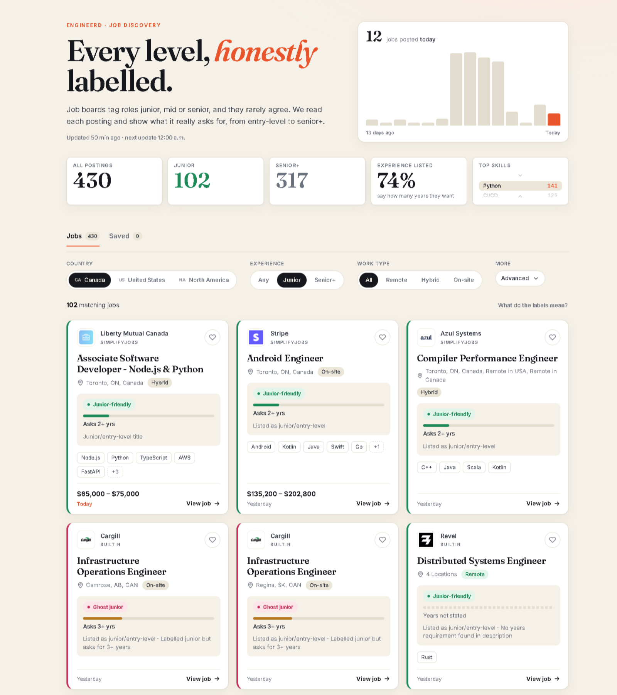

# Engineerd — Job Discovery Platform
<p align="center">
  
</p>

Engineerd collects software job postings from several job boards and shows what each one **really** asks for. Job boards label almost everything "junior", so Engineerd opens each posting, reads the years of experience it requires, and labels it honestly, from entry-level to senior+.

**Live demo:** https://engineerd.vercel.app
**Video walkthrough:** [Watch the demo](https://github.com/kendelja/engineerd/blob/main/EngineerdDemoVideo.mp4)

<p align="center">
  
</p>

## What it does

* **Honest experience labels.** Each job gets a junior-fit label: *Junior-friendly*, *Ghost junior* (labelled entry-level but asks for 3+ years), *Stretch*, *Senior-level*, or *Not verified*. A legend on the page explains each one.
* **Years-required meter.** Every card shows a bar for the years the posting asks for, so the requirement reads at a glance.
* **Skills at a glance.** Known languages and tools are pulled from the posting, and the top skills across all jobs are shown as a scrollable list.
* **Country tabs.** Canada, United States and North America each show only the jobs open to that market.
* **Filters.** Experience (Any / Junior / Senior+), work type (Remote / Hybrid / On-site), years required, and hiding ghost-junior jobs.
* **Activity chart.** How many jobs were posted each day over the last two weeks, per country.
* **Saved jobs** are kept in the browser.
* **Dark mode**, a mobile-friendly layout, and social preview tags for sharing.

## Where the jobs come from

* **Built In**, Canada and US feeds, with each job's own page read for the full requirements.
* **Wellfound**, role pages for each market.
* **SimplifyJobs**, through its public search API (Canadian locations only for now).

Job descriptions are read to work out requirements and skills, then discarded. Only the derived fields are stored. Every card links to the original posting.

## Tech stack

* **Backend:** Python, FastAPI, APScheduler
* **Scraping and parsing:** Playwright (headless Chromium), BeautifulSoup, httpx
* **Database:** PostgreSQL
* **Frontend:** React, Vite
* **Hosting:** Railway (API, in a Docker container), Vercel (frontend), Neon (PostgreSQL)

## How it works

```
Job boards (Built In, Wellfound, SimplifyJobs)
     ↓
Scrapers (Playwright / HTTP) ──► Parsers (per source)
     ↓
Normalization → Validation → Eligibility (title, country)
     ↓
Detail pages (requirements, skills)  →  Junior-fit analysis
     ↓
Deduplication → PostgreSQL
     ↓
FastAPI  ──► React dashboard
     ↑
Scheduler: runs four times a day (ingest and log each run)
```

Source-specific scrapers and parsers feed one shared pipeline, so adding a new job board means writing one scraper and one parser.

## Running it locally

**Requirements:** Python 3.12, Node.js 20+, and a PostgreSQL database (a free Neon database works).

**1. Backend**

```bash
cd Backend
python -m venv .venv
.venv\Scripts\activate          # Windows (use source .venv/bin/activate on macOS/Linux)
pip install -r requirements.txt
playwright install chromium
cp .env.example .env            # then fill in DATABASE_URL and, optionally, the rest
```

Create the tables and apply the migrations, then start the API:

```bash
psql "$DATABASE_URL" -f ../database/schema.sql
python -m scripts.backfillAnalysis      # applies migrations 001-003
python -m scripts.backfillMarkets       # applies migration 004 and fills the country tabs
uvicorn app.main:app --reload
```

**2. Frontend**

```bash
cd frontend
npm install
npm run dev
```

Open http://localhost:5173. The frontend talks to http://localhost:8000 by default.

**Loading jobs.** The database starts empty. Trigger a refresh with `POST /jobs/ingest?market=canada` (send the `X-Admin-Token` header if you set `ADMIN_TOKEN`), or wait for the next scheduled run.

## Configuration

Settings are read from environment variables. See `Backend/.env.example` and `frontend/.env.example`.

| Variable | Where | Purpose |
|---|---|---|
| `DATABASE_URL` | Backend | PostgreSQL connection string |
| `SIMPLIFYJOBS_API_KEY` | Backend | Key for the SimplifyJobs search API |
| `ADMIN_TOKEN` | Backend | Enables manual refresh; leave unset to disable it |
| `CORS_ORIGINS` | Backend | Comma-separated frontend origins allowed to call the API |
| `INGEST_SCHEDULE_ENABLED` | Backend | `1` (default) or `0` to turn scheduled runs off |
| `INGEST_HOURS` | Backend | Hours to run, default `0,6,12,18` |
| `INGEST_MARKETS` | Backend | Markets to run, default `canada` (e.g. `canada,usa`) |
| `INGEST_TIMEZONE` | Backend | Default `America/Toronto` |
| `API_URL` | Frontend (build) | Backend address, e.g. `https://your-api.example.com` |

## Deployment

* **API:** build the included `Dockerfile` (it installs Chromium) and run it as a single instance, so the scheduler only runs once.
* **Frontend:** deploy the `frontend` folder to Vercel with `API_URL` set to the API's address.

## Testing

```bash
cd Backend
python -m pytest
```

The tests cover the junior-fit analysis, the parsers, the country and title rules, the scheduler settings, and manual refresh authorisation.

## Limitations

* The junior-fit labels are heuristics built from the posting text. They can be wrong, and the legend says so.
* US jobs come from Built In and Wellfound. SimplifyJobs is configured for Canadian locations only.
* Postings that list many locations (for example "14 Locations") can't be placed in one country, so they appear in every tab.

## Roadmap

* [x] Add additional job sources (Built In, Wellfound, SimplifyJobs)
* [x] Add advanced filtering
* [x] Add scheduled ingestion
* [x] Deploy application
* [ ] Read individual cities for multi-location postings
* [ ] Add job relevance/match scoring
* [ ] Add AI-assisted job matching

## Why I Built It

Engineerd was built to cut through the noise of job searches and to give a practical project for **full-stack development, web scraping, data engineering and API development**. It's also the foundation for matching jobs to a candidate's skills in the future.
